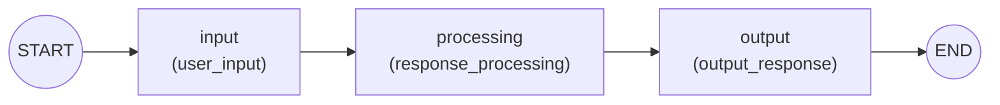

# Simple LangGraph Agent System

A minimal Python project demonstrating how to build, compile, and run a linear state-graph workflow using [LangGraph](https://github.com/langchain-ai/langgraph).

This project serves as an introductory template for LangGraph concepts—typed state management, message reducers, graph nodes, and directed edges—using a simulated response generator before integrating a real LLM.

---

## Project Architecture & Workflow

The application defines a deterministic, three-node linear graph compiled with `StateGraph`:



### Project Structure

| File | Description |
| :--- | :--- |
| `main.py` | Constructs and compiles the `StateGraph`, runs the interactive CLI conversation loop, and invokes Mermaid PNG generation for the graph diagram. |
| `ultils.py` | Defines the shared `State` schema (`TypedDict`) and the three node functions (`user_input`, `response_processing`, `output_response`). |
| `requirements.txt` | Lists the Python dependencies required to run the application. |
| `.gitignore` | Excludes Python caches, virtual environments, environment variables, IDE configs, and OS files from Git. |

---

## Project Analysis

### How It Works

1. **State Definition (`ultils.py`)**:
   - `State` is a `TypedDict` containing a `messages` field annotated with LangGraph's `add_messages` reducer.
   - Instead of overwriting `messages` on each node transition, `add_messages` appends new messages to the existing message list automatically.
2. **Graph Nodes (`ultils.py`)**:
   - `user_input`: Prompts the user in the terminal (`Question: `), validates that the input is a non-empty string, and appends a `HumanMessage` to `state["messages"]`. Raises a `ValueError` on blank input.
   - `response_processing`: Reads the latest message's `.content`, validates it, prints the current state for debugging, and returns a simulated answer string (`[simulated answer]`).
   - `output_response`: Prints the final state and the latest message object (`state["messages"][-1]`), then returns the state.
3. **Execution Loop (`main.py`)**:
   - Compiles the graph with `graph.compile()`.
   - Runs an infinite `while True` loop that invokes the graph with an initial seed message (`HumanMessage(content="How can I help you?")`) and asks whether the user wants to continue.
   - After exiting the loop, calls `Image(compiled.get_graph().draw_mermaid_png())` to render the graph diagram.


## How to Run

### Prerequisites

- **Python 3.9+** installed on your machine
- Internet access (required when exiting the loop if `draw_mermaid_png()` fetches the diagram via `mermaid.ink`)

### 1. Clone the Repository

```bash
git clone https://github.com/JoaoSantosss/langgrapgh-simple-agent-system.git
cd langgrapgh-simple-agent-system
```

### 2. Create and Activate a Virtual Environment

**macOS / Linux:**

```bash
python3 -m venv .venv
source .venv/bin/activate
```

**Windows (PowerShell):**

```powershell
python -m venv .venv
.venv\Scripts\Activate.ps1
```

### 3. Install Dependencies

```bash
pip install -r requirements.txt
```

### 4. Run the Application

```bash
python main.py
```

### 5. Example Usage

```text
Question: What is LangGraph?

Received query: What is LangGraph?

State on response processing: {'messages': [HumanMessage(content='How can I help you?', ...), HumanMessage(content='What is LangGraph?', ...)]}
genereted response: 
The answer to your question 'What is LangGraph?' is: [simulated answer]

State on output function: {'messages': [...]}
content="\nThe answer to your question 'What is LangGraph?' is: [simulated answer]\n" ...
Do you want to continue? (y/n)
```

